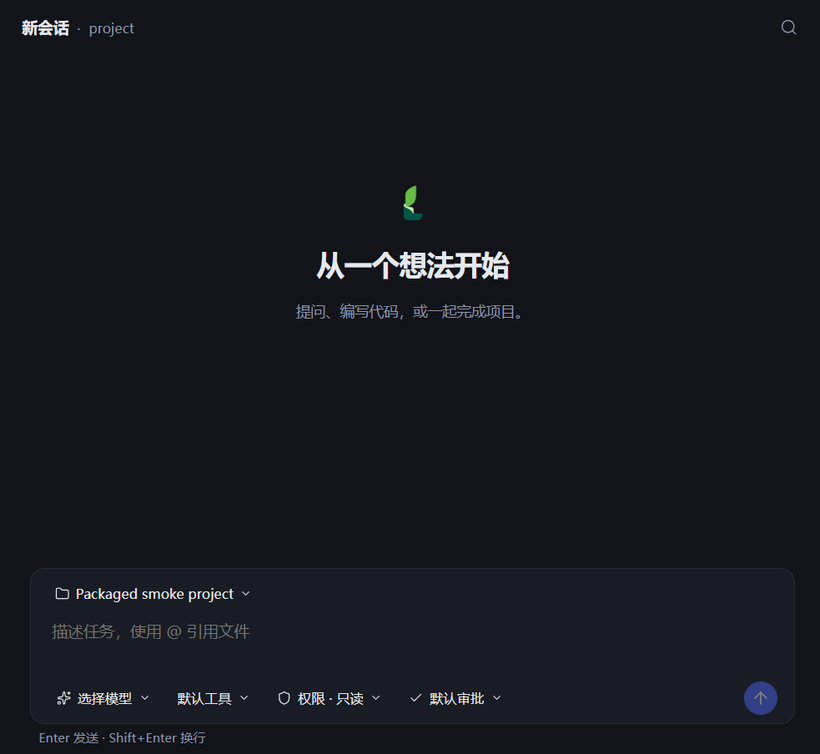
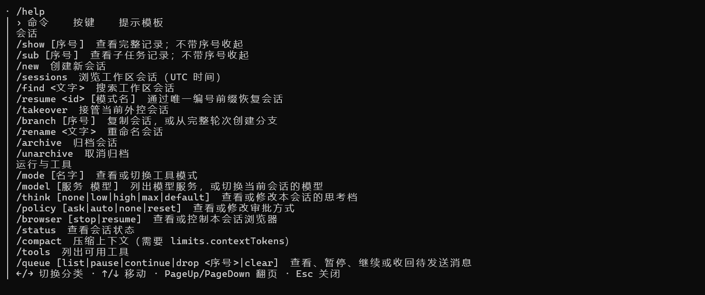

<div align="center">
  
  <h1>Ligule</h1>
  <p>共享 Agent Core 的 CLI、TUI 与桌面 AI 助手</p>
  <p>
    <a href="README.en.md">English</a> ·
    <a href="desktop/README.md">Desktop</a> ·
    <a href="tui/README.md">CLI / TUI</a> ·
    <a href="core/README.md">Core</a>
  </p>
  <p>
    <a href="https://github.com/xswt442-cmd/ligule/actions/workflows/ci.yml"></a>
    <a href="https://img.shields.io/npm/v/ligule"></a>
    <a href="https://nodejs.org"></a>
    <a href="https://github.com/xswt442-cmd/ligule/releases/latest"></a>
    <a href="LICENSE"></a>
  </p>
</div>

## 下载

桌面版从 [GitHub Releases](https://github.com/xswt442-cmd/ligule/releases/latest) 下载。Windows 提供 NSIS 安装程序，Linux 提供 AppImage 与 deb。

CLI 与 TUI 通过 npm 安装：

```sh
npm install -g ligule
```

## 功能

- **共享项目上下文**：会话归属工作区，可从已完成轮次创建分支并导出 Markdown。
- **受控的工具操作**：文件、命令、Skills 与 MCP 经 Permission 访问边界、Policy 风险判定和审批机制约束。
- **三种使用入口**：CLI 适合单次任务与脚本，TUI 和桌面版适合持续工作。
- **统一 Agent Core**：Host 组织模型与工具，Kernel 执行校验和 Policy，Session JSONL 记录可恢复的执行过程。
- **Agent Control（外部控制）**：为本地 MCP 控制者预先授予项目专属的权限上限；控制者通过 Grant 管理会话，不能越权或绕过危险操作拒绝。

## Agent 框架

Ligule 的 CLI/TUI 与桌面版共用 [Agent Core](core/README.md)。Node.js Host 组织模型、配置和 Session，Kernel 对工具参数、目标及 Policy 执行校验；会话记录支持恢复，未确定结果的工具调用不会自动重放。Electron 桌面版以独立 Host 进程复用相同的执行语义。

## 快速开始

CLI 与 TUI 需要 Node.js 24 或更新版本。安装后，在项目目录执行单次任务：

首次运行前，请先配置模型服务和凭据；CLI/TUI 的配置步骤见[模型服务配置](docs/guide.zh-CN.md#配置模型服务)，桌面版可在「设置 → 模型服务」中添加。

```sh
cd /path/to/your-project
ligule run "检查项目结构并提出建议"
```

运行 `ligule` 可启动终端界面。桌面版首次启动会准备默认工作区；之后可在设置中调整。

## 界面预览





## 配置

桌面版在「设置 → 模型服务」中配置服务与模型；CLI/TUI 使用同一配置。完整字段、凭据来源和模型选择方式见[使用手册](docs/guide.zh-CN.md)。`LIGULE_HOME` 可设置为绝对路径，用于更换用户数据根目录。

## 文档

- [使用手册（简体中文）](docs/guide.zh-CN.md) · [User guide (English)](docs/guide.en.md)
- [Agent Control（MCP）指南](docs/agent-control/guide.zh-CN.md) · [Agent Control guide (English)](docs/agent-control/guide.en.md)
- [架构说明](docs/development/ARCHITECTURE.zh-cn.md) · [Architecture](docs/development/ARCHITECTURE.en.md)
- [贡献与验证](docs/development/CONTRIBUTING.zh-cn.md) · [Contributing and checks](docs/development/CONTRIBUTING.en.md)
- [CLI/TUI 更新记录](tui/CHANGELOG.md) · [桌面版更新记录](desktop/CHANGELOG.md)
- [维护者发行流程](docs/development/RELEASE.md)

## 许可证

[MIT](LICENSE)
