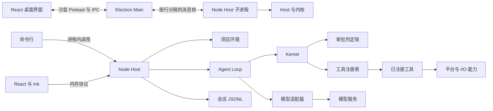
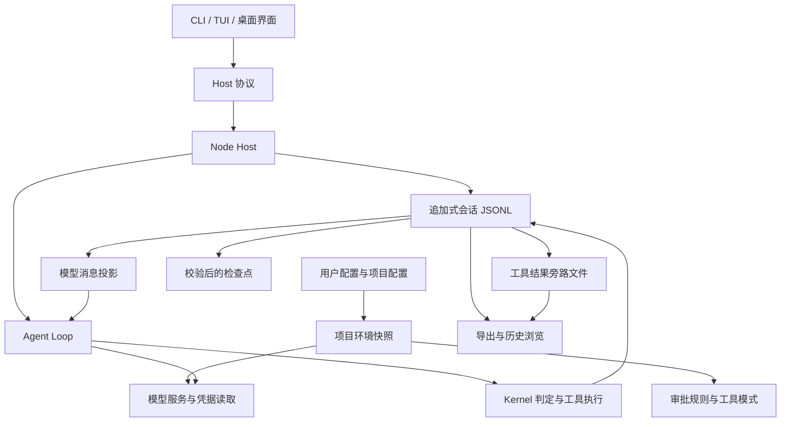

# 架构说明

[简体中文](ARCHITECTURE.zh-cn.md) · [English](ARCHITECTURE.en.md)

本文根据当前源码说明 ligule 的运行结构、一次 Agent Loop 和会话数据路径。工作区有三个源码模块：`core/` 是共享 Agent Core，`tui/` 是 CLI/TUI 产品，`desktop/` 是 Electron 产品。依赖方向为 `tui → core ← desktop`；Core 内部继续区分 Kernel、Host、Session、Model、Policy 与 Tools。产品分别通过 npm `ligule` 和 GitHub Release 发布，Core 不单独发版。

本文面向阅读或修改仓库的贡献者，说明组件职责、依赖方向、一次请求的执行路径和会话恢复。协议字段与模块细节以链接到的源码为准。

## 运行时与执行

- [运行结构](#运行结构)
- [Kernel、插件、工具与能力](#kernel插件工具与能力)
- [一次 Agent Loop](#一次-agent-loop)

## 会话数据与恢复

- [会话记录与恢复](#会话记录与恢复)
- [会话数据路径](#会话数据路径)

## Host 与客户端

- [Host 协议与客户端](#host-协议与客户端)
- [相关文档](#相关文档)

### 运行结构



`ligule run` 与直接运行 `ligule`（或使用兼容命令 `ligule tui`）会在界面所属的 Node.js 进程中创建 Host。TUI 通过内存连接发送协议消息。桌面前端只通过固定的沙盒 Preload API 与 Electron Main 通信；Main 将协议帧转发给独立 Node Host，并管理窗口、原生交互和进程生命周期。Node Host 管项目环境、会话、审批与模型请求。入口分别见[命令行](../../tui/src/cli.ts)、[TUI 启动器](../../tui/src/tui/start.ts)、[消息连接](../../core/src/host/connection.ts)、[Electron IPC](../../desktop/electron/ipc.ts)和[Preload API](../../desktop/electron/preload.ts)。

### Kernel、插件、工具与能力

Kernel 从空工具注册表开始。Host 通过[装配器](../../core/src/kernel/assembly.ts)安装插件；插件可以注册工具和提示片段，并返回清理动作。工具模式从已注册工具中选择可交给模型的项目，并选择提示片段；模式不实现工具，也不作审批决定。

工具是模型可调用的契约，包含名称、说明、JSON 参数模式和执行函数。工具实现可以调用 [`src/capability/`](../../core/src/capability/) 下的平台能力，例如路径检查、命令执行、网络解析或剪贴板访问。能力本身不会自动成为模型可调用工具。审批结果中的 `capability` 字段用于标记本次判定的操作。

模型提出的每个工具调用都会进入 [`kernel.call`](../../core/src/kernel/kernel.ts)。Kernel 先检查工具注册和参数，再解析声明的命令或网络目标，随后调用审批判定链。判定链按既定顺序应用限制、守卫、配置规则、自动审批条件和用户审批。只有获准的调用会进入工具实现。Kernel 会记录判定结果，以及完成、拒绝或失败的工具结果；模型清单只包含工具名称、说明和参数模式。

### 一次 Agent Loop

```mermaid
sequenceDiagram
  actor User as 用户
  participant Adapter as CLI / TUI / 桌面适配器
  participant Host as Node Host
  participant Loop as Agent Loop
  participant Session as 会话记录
  participant Provider as 模型服务
  participant Kernel as Kernel 与审批链
  participant Tool as 工具与平台能力
  User->>Adapter: 提交一条消息
  Adapter->>Host: run.start
  Host->>Session: 追加用户事件与本轮设置
  Host->>Loop: 使用会话、提供方与 Kernel 运行
  Loop->>Session: 读取模型视图
  Loop->>Provider: 发送提示、工具清单与消息
  Provider-->>Loop: 流式文本、推理与工具调用
  Loop->>Session: 追加助手内容与工具调用
  alt 模型返回工具调用
    Loop->>Kernel: 校验并请求判定
    Kernel->>Kernel: 检查限制、规则与审批
    opt 判定需要用户审批
      Kernel->>Host: 等待本会话的审批答复
      Host-->>Adapter: approval.request
      Adapter-->>User: 显示审批卡
      User-->>Adapter: 允许或拒绝
      Adapter->>Host: approval.respond
      Host-->>Kernel: 返回判定结果
    end
    Kernel->>Tool: 执行获准的工具
    Tool-->>Kernel: 返回结果
    Kernel->>Session: 记录判定与工具结果
    Loop->>Provider: 带上工具结果继续请求
  else 模型完成本轮
    Loop->>Session: 追加完成、取消或失败终态
  end
  Host-->>Adapter: 状态、事件与最终结果
  Adapter-->>User: 显示会话更新
```

[Agent Loop](../../core/src/kernel/loop.ts) 执行一轮用户输入及所需的模型与工具迭代：

1. 将用户输入和本轮有效设置追加到会话记录。
2. 生成系统提示、工具清单，并从会话记录构建模型消息。
3. 若启用了上下文压缩，在发送前检查请求大小；服务报告请求过大时，最多执行一次恢复压缩与重试。
4. 流式接收模型响应，将推理、文本和工具调用写入记录。
5. 通过 Kernel 执行工具调用，将结果写入记录，再按模型响应继续迭代。
6. 在本轮完成、取消或失败时写入一条终态。

### 会话记录与恢复

追加式 [JSONL 会话记录](../../core/src/session/session.ts)是对话事实来源。首行记录会话标识和项目信息；之后的事件记录用户与助手消息、工具调用和结果、轮次状态、模型选择及其他状态。会话锁阻止多个进程同时写入同一记录。

模型请求使用从记录计算出的投影。界面可以读取推理、标签、轮次信息和用量；按投影规则，这些内容不会全部进入模型消息。创建分支会复制整份记录，或复制到一轮完整结束处为止；父会话保持不变。

检查点是派生文件。使用前会核验格式、覆盖的序号区间以及相对于会话事件的摘要值。校验失败或文件不存在时，从 JSONL 记录重建模型视图。压缩只写检查点，不改写会话记录。过大的工具结果放在旁路文件中，记录保留读取和导出所需的引用。

重新打开会话时，若已派发的工具调用没有结果，恢复逻辑会记下 `tool_outcome_unknown`，不会重放该调用。这样可以重建有效的模型投影，同时避免重复执行结果未知的外部操作。

### 会话数据路径



配置层在 Host 启动项目环境时合并成快照。会话 JSONL 是消息和工具结果的来源；检查点与旁路文件保存可重新校验或取回的派生内容。历史浏览和导出读取记录与可用旁路文件，不以界面缓存作为会话事实来源。用户数据根和项目工作区分别管理用户级资料与项目归属。

### Host 协议与客户端

Host 协议在[协议表](../../core/src/host/protocol.ts)中定义方法、参数、审批请求、问题请求和通知。[`connection.ts`](../../core/src/host/connection.ts) 使用按行分隔的 JSON 消息。Host 在分派前校验方法参数，并持有会话状态；客户端通过协议创建或打开会话、启动或取消轮次、读取记录、回应待办和修改支持的设置。

CLI 命令直接调用 Host。TUI 在内存连接上使用相同协议。桌面前端通过固定的 Preload API 使用 IPC 连接 Electron Main，Main 只转发消息帧，不解释 Host 方法或会话数据。传输方式不同，Host 方法和 Kernel 行为保持共用。

### 相关文档

[术语表](GLOSSARY.zh-cn.md)定义项目用语；[贡献与验证](CONTRIBUTING.zh-cn.md)列出开发命令和检查范围；[使用手册](../guide.zh-CN.md)说明 CLI、TUI 和 Desktop 的用户操作。
