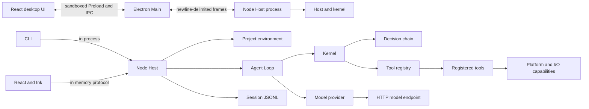
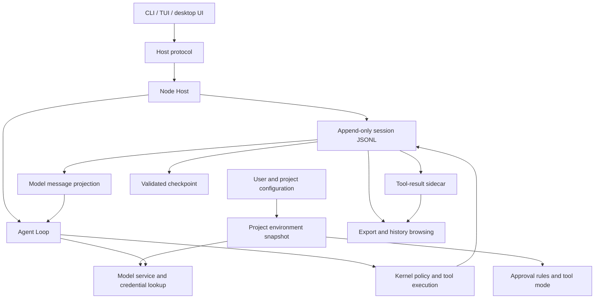

# Architecture

[简体中文](ARCHITECTURE.zh-cn.md) · [English](ARCHITECTURE.en.md)

The workspace has three source modules: `core/` is the shared Agent Core, `tui/` is the CLI/TUI product, and `desktop/` is the Electron product. Dependencies point `tui → core ← desktop`; Core itself keeps Kernel, Host, Session, Model, Policy, and Tools as distinct concepts. The products ship independently through npm `ligule` and GitHub Releases. Core has no independent release. The [kernel](../../../core/src/kernel/kernel.ts) executes registered tools and applies the decision chain. The [Host](../../../core/src/host/host.ts) assembles that kernel with a project environment, model provider, session log, and client protocol.

This guide is for contributors reading or changing the repository. It explains component ownership, dependency direction, one request's execution path, and session recovery. The linked source files remain authoritative for protocol fields and module details.

## Runtime and execution

- [Runtime map](#runtime-map)
- [Kernel, plugins, tools, and capabilities](#kernel-plugins-tools-and-capabilities)
- [One Agent Loop turn](#one-agent-loop-turn)

## Session data and recovery

- [Session records and recovery](#session-records-and-recovery)
- [Session data flow](#session-data-flow)

## Host and clients

- [Host protocol and clients](#host-protocol-and-clients)
- [Related guides](#related-guides)

### Runtime map



`ligule run` and the default `ligule` invocation (or the compatible `ligule tui` command) create a Host in the Node process that owns the interface. The TUI sends protocol messages over an in-memory connection. The desktop frontend communicates with Electron Main through a fixed sandboxed Preload API; Main forwards protocol frames to the independent Node Host and manages windows, native interactions, and process lifecycle. The Host owns sessions, project state, policy, and model requests. See the [CLI](../../../tui/src/cli.ts), [TUI adapter](../../../tui/src/tui/start.ts), [frame transport](../../../core/src/host/connection.ts), [Electron IPC](../../../desktop/electron/ipc.ts), and [Preload API](../../../desktop/electron/preload.ts).

### Kernel, plugins, tools, and capabilities

The kernel starts with an empty tool registry. The Host installs plugins through the [assembly loader](../../../core/src/kernel/assembly.ts); a plugin registers tools and returns cleanup actions. The selected [tool mode](../../../core/src/kernel/modes.ts) restricts which registered tools enter the model manifest and selects named prompt fragments. It does not implement tools or provide an approval decision.

A tool is the model-callable contract: a name, description, JSON parameter schema, and execution function. Its implementation may call code under [`src/capability/`](../../../core/src/capability/), which performs environment-sensitive work such as path checks, shell selection, process management, network resolution, or clipboard access. A capability implementation is not automatically a model-callable tool. When policy records a `capability` label, that value names the operation used for that decision.

Every model tool call passes through [`kernel.call`](../../../core/src/kernel/kernel.ts). The kernel checks registration and arguments, resolves declared command or network targets, then asks the decision chain to evaluate the call. The chain applies restrictions, guards, configured rules, automatic approval checks, and user approval in its defined order ([policy implementation](../../../core/src/kernel/policy.ts)). Only an allowed call reaches the tool implementation. The kernel records the verdict and a result for completed, rejected, or failed calls; the model manifest contains only the tool name, description, and parameter schema.

The [Agent Loop](../../../core/src/kernel/loop.ts) performs one user turn and any model/tool iterations it requires:

1. Append the user event and the effective turn settings to the session.
2. Render the system prompt, build the registered tool manifest, and project the session into model messages.
3. If configured, compact the request before sending it or once after a provider reports an oversized request.
4. Stream a model response and append its reasoning, text, and tool calls to the session.
5. Run each tool call through the kernel, append its result, then continue the loop when the model requested more work.
6. Append one terminal turn event for completion, cancellation, or failure.

The [model adapters](../../../core/src/model/) implement the supported HTTP message formats. The Host selects a provider from the effective model service and reads credentials only when making a request.

### One Agent Loop turn

```mermaid
sequenceDiagram
  actor User
  participant Adapter as CLI / TUI / desktop adapter
  participant Host as Node Host
  participant Loop as Agent Loop
  participant Session as Session record
  participant Provider as Model service
  participant Kernel as Kernel and policy chain
  participant Tool as Tool and platform capability
  User->>Adapter: Submit a message
  Adapter->>Host: run.start
  Host->>Session: Append user event and turn settings
  Host->>Loop: Run with session, provider, and kernel
  Loop->>Session: Read model view
  Loop->>Provider: Send prompt, tool manifest, and messages
  Provider-->>Loop: Stream text, reasoning, and tool calls
  Loop->>Session: Append assistant content and tool calls
  alt The model requests a tool
    Loop->>Kernel: Validate and request a verdict
    Kernel->>Kernel: Check restrictions, rules, and approval
    opt User approval is required
      Kernel->>Host: Wait for approval in this session
      Host-->>Adapter: approval.request
      Adapter-->>User: Show approval card
      User-->>Adapter: Allow or refuse
      Adapter->>Host: approval.respond
      Host-->>Kernel: Return the verdict
    end
    Kernel->>Tool: Run an allowed tool
    Tool-->>Kernel: Return result
    Kernel->>Session: Record verdict and tool result
    Loop->>Provider: Continue with the tool result
  else The model completes the turn
    Loop->>Session: Append completed, cancelled, or failed status
  end
  Host-->>Adapter: Status, events, and final result
  Adapter-->>User: Show session updates
```

The loop appends the user input and effective turn settings, builds the model view, streams a response, and records each assistant event. Tool calls pass through kernel validation and policy before execution. The loop records their results and continues while the model requests more work. It appends one terminal status when the turn completes, is cancelled, or fails.

### Session records and recovery

The append-only [session JSONL record](../../../core/src/session/session.ts) is the source of truth for a conversation. Its first line identifies the record and project; later lines hold user and assistant messages, tool calls and results, turn state, model selection, and other events. Session locks prevent two processes from writing the same record at once.

The model view is a projection of the record, not a second transcript. Reasoning, labels, turn metadata, and usage remain available for display or recovery but are excluded from model messages where the projection rules require it. A branch copies a record or a prefix ending at a completed turn; it leaves the parent unchanged.

Checkpoints are derived files. Before using one, ligule verifies its format, covered sequence range, and digest against the session events. If validation fails or the checkpoint is absent, it rebuilds the model view from the JSONL record ([checkpoint validation](../../../core/src/session/checkpoint.ts)). Compaction writes a checkpoint and never rewrites the record ([compaction](../../../core/src/session/compaction.ts)). Oversized tool output is stored in a sidecar file; the record retains the reference needed to read or export the complete result.

When a session is reopened, recovery repairs dispatched tool calls that have no recorded result with an explicit unknown outcome. It does not replay them. This preserves a valid model projection without repeating an operation whose external effect may already have happened.

### Session data flow



Configuration layers are combined into a snapshot while the Host creates a project environment. The session JSONL is the source for messages and tool outcomes. Checkpoints and spill files contain derived data that can be validated or retrieved. History browsing and export read the record and available sidecars; a UI cache is not the source of session facts. The user data root and project workspace separately own user-level data and project attribution.

### Host protocol and clients

The Host protocol defines methods, request parameters, approval requests, question requests, and notifications in one [protocol table](../../../core/src/host/protocol.ts). [`connection.ts`](../../../core/src/host/connection.ts) carries newline-delimited JSON messages. The Host validates method parameters before dispatch and owns all session state; clients use protocol methods to create or open sessions, start and cancel turns, read records, answer requests, and change supported settings.

The CLI's single-turn commands call the Host directly. The TUI uses the same protocol over an in-memory connection. The desktop UI uses a TypeScript client through the fixed Preload API and Electron IPC; Main forwards frames without interpreting Host methods or session data. These transports differ, while the Host methods and kernel behavior remain shared.

### Related guides

The [glossary](GLOSSARY.en.md) defines shared terms. [Contributing and checks](CONTRIBUTING.en.md) lists development commands and validation scope. The [user guide](../guide.en.md) explains CLI, TUI, and desktop workflows.
